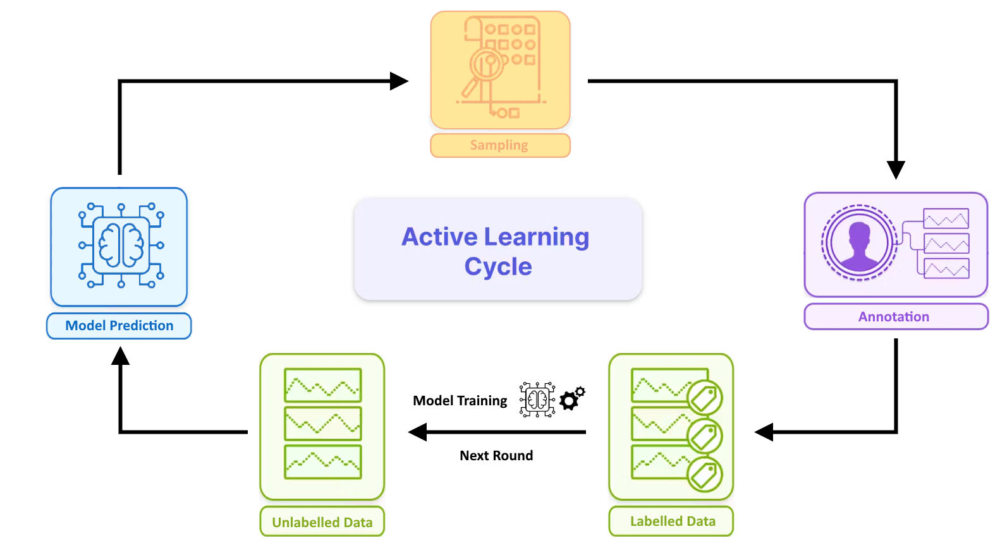
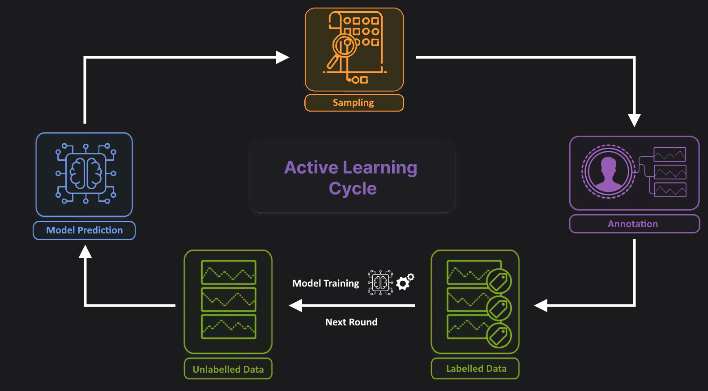
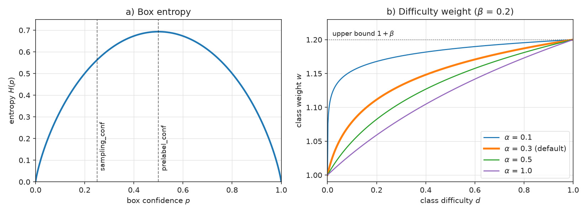
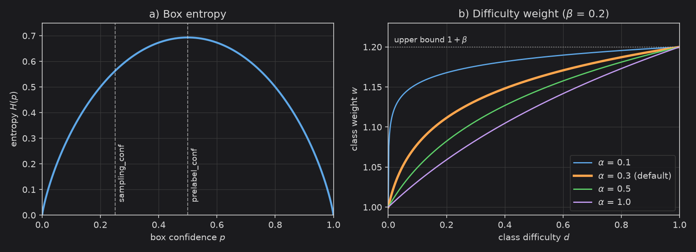

<!-- TODO: replace the cover with /assets/img/active_learning/cover.png when it exists -->

# Overview

REVISAR/CAMBIAR

An object detector is only as good as the data it was trained on, and for detection that means images with a box and a class for every object. Collecting images is easy; labelling them is slow and expensive, and labelling a random subset spends much of the budget on images that teach the model nothing new.

**Active learning** turns the question around: the model itself points at the images it would learn the most from. A human labels only those, the model is retrained, and the cycle repeats.

In this post I go through the basics of active learning and why object detection makes it harder. Then I present the loop I built: how a round works, how a zero-shot detector solves the "no model on day one" problem, how to use it when you already have a model and a dataset, the two samplers that choose the images, and how FiftyOne and CVAT glue everything together.

The full source code of the project is available on [GitHub](https://github.com/gprietos/Object-Detection-Active-Learning).

{: .light w="700" }
{: .dark w="700" }
_The active learning cycle_

# Introduction

Most modern computer vision models still rely on **supervised learning**, that is, learning to replicate expected outputs from labeled data. While self-supervised and multimodal pretraining have significantly improved model initialization, and foundation models can perform broad classification without prior training, **adapting models to custom or specialized tasks often still relies on labeled data**. Capturing images is usually cheap, but reliable labels are not.

This is particularly relevant in object detection, which requires precise spatial localization, fine-grained target classes, and adaptability to domain shifts; capabilities that zero-shot models frequently struggle to achieve on their own.

Labeling costs vary significantly by task. While image classification needs only a single class label per image, making manual annotation quick and simple, **object detection** demands a **tight bounding box and class label for every object in the scene**, taking several seconds per box, which is especially impactful in dense scenes with many targets. When factoring in quality control to catch errors, building a high-quality dataset becomes expensive and time-consuming, leaving dataset size almost always constrained by a labeling **budget**.

Another issue is that **not all images are equally useful to annotate**, as some teach the model far more than others:

- **Redundancy**: Labeling near-identical images adds little new information and can even bias the model toward over-represented scenes. Consecutive video frames are a typical case, since they are often almost identical.

- **Easy examples**: Once a model learns a specific image type, additional labels barely improve its performance, wasting the labeling budget. For instance, once a model reliably detects cars on sunny highways, adding a another hundred of those images barely changes its performance.

- **Edge cases**: Rare classes, unusual environments, or complex real-world conditions appear infrequently, yet they are precisely where the model is most likely to fail. Labeling these underrepresented scenarios is essential for ensuring model robustness in real-world unpredictable situations.

Randomly picking images to label just mirrors the flaws of the original dataset, wasting effort on repetitive, easy samples while leaving key edge cases out. So when working with a limited budget, the real question should not be "How do I label faster?" but **"Which images should I label?"**.

<!-- # What is Active Learning

**Active learning** is a family of methods in which the learner chooses the data it is trained on. Instead of receiving a fixed labelled dataset, the model asks an **oracle**, usually a human annotator, to label the samples it considers most informative: a form of *human-in-the-loop* machine learning.

Of the classic scenarios (synthesizing new samples to label, deciding on each sample of a stream, or ranking a pool), the usual one in practice is **pool-based sampling**: a large pool of unlabelled data is available and the model ranks it to choose what to label. Here it runs in **batch mode**, selecting a batch of images per round, since retraining a detector after every single label would be far too slow.

The loop is: **train** a model on the labelled data, **predict** on the unlabelled pool, **query** the most informative samples, have the oracle **label** them, **add** them to the labelled set and repeat, until the **budget** is spent or the model stops improving.

The heart of the method is the **query strategy**, the rule that decides what "informative" means. The main families are:

- **Uncertainty:** the samples the model is least sure about (lowest confidence, smallest margin between the top two classes, highest entropy), sometimes estimated with ensembles or MC dropout.
- **Diversity / representativeness:** samples that cover the data distribution well, whatever the model's confidence.
- **Hybrid:** both, usually uncertain samples first with diversity enforced among them.
- **Others:** query-by-committee, expected model change, or learning to predict the loss.

> **Why not just take the top-k most uncertain images?**
>
> Because uncertainty comes in bunches. If the model struggles with a dark tunnel entrance, it struggles with every frame of it, so the top 100 most uncertain images might be 100 views of the same tunnel. Each one is informative, but together they are redundant. This is why batch active learning usually adds a diversity step, and why the sampler in this project has two stages.
{: .prompt-info }

Two caveats: **random sampling is a surprisingly strong baseline**, so any method has to be measured against it, and active learning has a **cold-start problem**: you need a model to choose the data, but data to train the model. -->

<!-- NEW DRAFT (2026-10-25): compare with the two sections above, then delete the old ones and the "(new draft)" in the titles. Its footnotes are defined at the end of this block. -->

<!-- # What is Active Learning (new draft)

In ordinary supervised learning the dataset is fixed before training starts. **Active learning** lets the model take part in building it: the model looks at data nobody has labelled yet, points at the examples it expects to learn the most from, and a human (the **oracle**, in the literature's terms) labels only those. The goal is to reach a given accuracy with as few labels as possible, or the best accuracy a fixed labelling **budget** can buy[^settles].

**The setting.** The literature distinguishes three scenarios: the model can synthesize new examples and ask for their labels, decide one by one whether to keep each sample of a stream, or rank a **pool** of unlabelled data that is already collected. The last one, **pool-based** active learning, matches how vision datasets are actually built, and it is the one this post uses. With deep networks it also runs in **batch mode**: retraining after every single label would take far too long, so each round selects a whole batch. A round therefore goes: train on the labelled set, score every image of the pool, select a batch, have it labelled, add it to the labelled set, and repeat until the budget runs out or the model stops improving.

**What makes an example worth labelling?** The rule that scores the pool is called the **acquisition function**, and almost all of them build on one of three ideas.

- **Uncertainty: label what the model is unsure about.** If the model is already confident and right about an image, its label teaches little. Uncertainty comes in two kinds, though. Some is in the data itself: a blurry, distant or occluded object stays ambiguous no matter how much you label (*aleatoric* uncertainty). Some comes from what the model hasn't seen yet (*epistemic* uncertainty), and only that kind goes away with more labels. A single model's confidence mixes the two, and deep networks are often overconfident even when they are wrong. Methods that ask several models (an ensemble, dropout kept on at prediction time, a committee) and measure how much they **disagree** isolate the epistemic part better, at the price of several predictions per image[^dbal].
- **Representativeness: label what covers the data.** Uncertainty looks at images one at a time; it doesn't care whether the selected ones look alike, or whether they are typical of the data at all. Diversity methods look at the pool as a whole, usually in a feature space where similar images lie close together. They come in two flavours that behave quite differently. **Coverage** methods such as core-set[^coreset] pick the image farthest from everything selected so far, so they reach the edges and outliers of the data first. **Representative** methods cluster the pool and pick the most central image of each cluster, so they favour typical examples of the large groups.
- **Expected impact: label what would change the model most**, for instance the example whose label would produce the largest gradient, or the one with the highest loss predicted by a small auxiliary network. These target the goal more directly, but they are usually costlier and need access to the model's internals.

**Why the ideas are combined.** In batch mode, plain uncertainty has a well-known failure: the most uncertain images come in bunches.

The standard remedy is a hybrid: shortlist the most uncertain images, then choose a diverse subset of the shortlist[^zhdanov]. Some methods merge both into a single step, such as BADGE[^badge]. The sampler in this project is of the shortlist-then-diversify kind.

**What practice teaches.** Four lessons from the literature temper the promise:

- **Random sampling is a strong baseline.** Under careful evaluations with equal budgets and training, many published strategies beat it by small margins, and some not at all[^munjal]. A strategy is judged by its **learning curve** (accuracy against the number of labelled images) next to random's.
- **The best strategy depends on the budget.** With very few labels, picking typical examples works best, because the model is too weak for its uncertainty to mean much; uncertainty takes over once the model is decent[^hacohen]. This is the **cold-start** problem: the first labels can't be chosen by a model that doesn't exist yet.
- **The labelled set is biased on purpose.** It over-represents hard and unusual cases, so it is no longer a random sample of the data, and accuracy measured on it says little. Evaluation needs a separate test set drawn at random.
- **The selection is tied to the model that made it.** Images chosen with one model are not necessarily the most useful ones for another, so changing the architecture later can erase part of the gain[^lowell].

For a broader tour of acquisition functions, Lilian Weng's overview is an excellent next read[^weng]. -->

<!-- END OF NEW DRAFT -->

# What is Active Learning

**Active learning** is a machine learning approach in which **the model helps construct its own dataset by selecting which samples to label**. The model reviews unlabelled samples, identifies which examples it expects to learn the most from, and requests labels for those from a **human annotator** (the **oracle**). The goal is to maximize model performance while keeping labeling costs as low as possible.

In practice, active learning typically relies on **pool-based sampling**: a model evaluates a large pool of unlabelled data and ranks the samples to decide what to label. Since retraining a vision model after every single label would be far too slow, images are selected and labelled in **batches**.

This batching process turns active learning into an iterative loop. Every **round** follows the same cycle:

1. **Train** the model on the current labelled set.
2. **Score** the unlabelled pool using an acquisition function.
3. **Query** the most informative batch of samples.
4. **Annotate** the batch via the oracle and add it to the labelled set.

This cycle repeats until the annotation budget is exhausted or performance stalls.

## Active Learning Samplers

What makes an example worth labelling? The rule that scores the pool and decides what informative means is called **the acquisition function**. There are different strategies:

- **Uncertainty**:  Label what the model is least sure about. If the model is already confident and right about an image, its label teaches little. Data carries **aleatoric uncertainty**, inherent noise and ambiguity like blur or occlusion, while model knowledge gaps create **epistemic uncertainty**. This last type of uncertainty is the only type reduced by new labels. Because standard deep networks mix both and are frequently overconfident when wrong, single-model confidence can be unreliable[^weng]. Advanced strategies instead measure disagreement across ensembles, committees (Query-by-Committee)[^qbc], or MC dropout[^dbal], to isolate true epistemic uncertainty.

- **Diversity**: Label what broadly covers the data distribution. Diversity methods analyze the unlabelled pool as a whole in feature space to ensure the chosen batch spans varied environments, scenarios, and patterns. There are two main strategies. **Coverage** methods[^coreset] (k-center) spread the batch across feature space by minimising the largest distance from any image to its nearest selected one, reaching sparse regions and edge cases, but also outliers. **Representative** methods[^hacohen] (k-means, k-medoids) instead minimise the average distance, picking the images closest to cluster centres and so favouring typical images from dense, dominant groups.

- Others:

  - **Expected Model Change**[^egl]: Label what would change the model's parameters the most, such as selecting images expected to produce the largest gradients during training. These directly target model updates, but require deeper access to model internals.
  
  - **Predicted Loss**[^yoo]: Train a small auxiliary network or model head alongside the main detector to predict the loss an unlabelled image would produce. The images with the highest predicted loss are flagged as the most informative.
   
  - **Adversarial**[^vaal]: Label images that look least like the labelled set. These methods train a discriminator to tell labelled images from unlabelled ones in a learned latent space, then select the images it most confidently judges unlabelled.

  - **Contrastive**[^cal] : Label images that look alike to the model but get different predictions. These methods score each unlabelled image by how much its prediction differs from those of its nearest labelled neighbours in feature space, flagging images near decision boundaries.



These strategies are not mutually exclusive and are often combined into **hybrids**. Because the most uncertain images are frequently near-duplicates, a common approach is to select the most uncertain candidates first, then select a diverse subset from that shortlist[^sa] [^zhdanov]. Other methods merge uncertainty and diversity altogether into a single step[^badge].

Active learning also has caveats worth keeping in mind. The labelled set ends up **biased on purpose** towards hard and unusual cases, so evaluation needs a separate test set drawn at random. It is also **tied to the model** that chose it, so switching architectures later can erase part of the gain[^lowell]. Finally, the best **strategy depends on the budget**. With very few labels the model is too weak for its uncertainty to mean much, so picking typical samples works better, and uncertainty takes over only once the model is decent[^hacohen].

All that said, **random sampling** remains a strong baseline. Under careful evaluations, many published strategies beat it by only small margins. Any strategy should therefore be judged by its **learning curve**, which plots accuracy against the number of labelled images, alongside random's.

<!-- **The cost of labelling.** The budget is counted in images, but the effort is in boxes: an image with forty objects costs far more than one with two, so "most informative" and "most informative per minute of annotation" are different questions. Showing the model's boxes to annotators as **pre-labels** turns drawing into correcting and saves a lot of time, but people tend to accept what they are shown, so pre-labels can carry the model's mistakes into the labels. -->
<!-- i think this is an important topic to talk but not in this sector. -->

<!-- **The cost of a round.** Training a detector takes minutes to hours, so rounds are few and batches are large, which makes redundancy inside a batch more expensive. Every round also needs a fixed, labelled, randomly drawn test set to know whether it helped. And the human annotation in the middle can take days, so the loop has to survive being stopped and restarted. -->
<!-- this was teased in the introduction, so it is redundant -->

<!-- **Day one.** Before the first labels there is usually no detector that knows your classes, so neither uncertainty nor the model's own features are available to choose the first batch. Open-vocabulary detectors, which find objects described by a text prompt, offer a way around it. -->
<!-- i think this is an important topic to talk but not in this sector, this is not object detection specific issue. there is a roound 0 zero shot model initialization section about this. -->

<!-- Detection has its own line of active learning work, such as contextual diversity (CDAL)[^cdal], multiple instance uncertainty (MI-AOD)[^miaod] and PPAL[^ppal], which this project builds on. The next section describes how. -->
<!-- i want to cite papers about active learning for object detection research but not explicitly, include the citation in the text when the paper content matches what is being told. Also, ppal will be directly referenced later as the implementation is heavely inspired by it -->

## Active Learning for Object Detection

Most active learning literature for image datasets comes from image classification, where each image has one label and the model gives one probability per class. Object detection instead outputs a variable number of boxes per image, each with its own class and confidence score. This changes how samplers compare and score images, and raises several challenges:

- **Many boxes, one score.** Annotators label whole images, but uncertainty is measured per box. Summing box scores favours crowded images, the maximum lets a single doubtful box decide, and the average can hide one hard object among many easy ones. Many uncertain boxes are also just background, which can make an image look more informative than it is[^miaod].

- **Two ways to be wrong.** A box can be wrong about **what** the object is or **where** it is. Detector confidence mostly reflects the first, so a model can be sure it sees a car and still misplace its edges. Localization uncertainty needs its own estimate, such as how much the boxes move when noise is added to the image[^kao].

- **Doubt is filtered out**.  Inside a detector, many candidate boxes compete for each object, and when they disagree on the class or position, that disagreement is a direct sign of uncertainty. The final output keeps only one box per object, either because non-maximum suppression removes the rest or because the model is trained not to produce them, and confidence thresholds drop the weakest ones. As a result, the **sampler only sees the model's final decisions, not its hesitation**.

- **No boxes, no score.** An image without detections is either truly empty, which teaches the detector what background looks like and helps prevent false positives, or full of missed objects, a major flaw worth labelling. Box-based scores can't see either case.

- **Class imbalance.** Some classes appear in far fewer images than others, and since an image chosen for a rare object often brings common ones with it, they remain underrepresented in the labelled set. The model then learns them poorly and often misses them, leaving few boxes for an uncertainty sampler to select. Weighting uncertainty by how hard each class currently is helps counter this[^ppal].

- **Two kinds of similarity.** Two images can be alike as **scenes** or because they contain **similar objects**, and the two often disagree. Comparing whole images can therefore miss differences in what they contain, which is why some methods compare images by the objects the model detects in them[^cdal].

# The Proposed Solution

The sampling strategy I chose for this project is mostly inspired by **PPAL** (Plug and Play Active Learning for Object Detection)[^ppal]. Unlike many other methods, which add extra heads or modify the training loop, PPAL only needs the detector's outputs, so **it works with any detector without changing the active learning pipeline**. It implements a sample querying strategy in two stages:

1. **Difficulty Calibrated Uncertainty Sampling (DCUS):** box uncertainties are weighted by how hard their class is for the current model, and the most uncertain images form a candidate pool.
2. **Category Conditioned Matching Similarity (CCMS):** images are compared by matching their objects class by class, and a diverse subset of the candidates is selected.

Rather than following PPAL strictly, I adapted both samplers with a few modifications that I will describe in detail in the [Samplers](#the-samplers) section.

However, a sampling strategy is only one piece of the active learning puzzle. To use it on a real project, I needed a detector to train, a database to store and manage images and predictions, a labelling tool for human annotation, a way to measure progress each round, and a reliable way to handle long annotation cycles. So rather than implementing the sampler strategy alone, my goal was to **build the whole loop end-to-end**, from taking unlabeled images all the way to an annotated dataset.

Every labelling project is different. One dataset might be full of near-duplicate video frames with heavy class imbalance, while another is a mix of diverse images captured under unpredictable conditions. Add different target classes, budgets and starting points, and no single rigid pipeline solution fits them all. Because of this, I wanted to build it from **interchangeable, configurable pieces**, so adapting to a new workflow means changing only configuration rather than needing to reimplement the loop.

In practice, this came down to a few design principles:

- **Model-agnostic.** The sampling strategy only uses the detector's predictions, it doesn't add new models or need access to the detector's internals unlike other stategies, so any detector can be plugged in.
- **Built on existing tools.** Instead of reimplementing data management and annotation, the loop relies on existing tools. **FiftyOne**[^fiftyone] keeps images, predictions, labels and evaluations in one dataset, and **CVAT**[^cvat] handles human labelling, with the model prediction's boxes as pre-labels to correct rather than draw from scratch.
- **Any starting point.** The loop can start from nothing, using a zero-shot detector to bootstrap the first model and the first labelled samples. It can also start from an existing model, with or without its original dataset, and keep improving both.
- **Resumable.** Both labelling and retraining the detector between rounds can take hours or even days. The loop therefore should save its state after every step, so it can be interrupted at any point and resumed later without losing progress.
- **Measurable.** Every round is evaluated against the same held-out test set. Using a simulated annotator on fully labeled datasets allows strategies to be compared quickly and objectively.

## The Active Learning Cycle

Every active learning round works on a single dataset, whose images are split into three groups:

- **Unlabelled pool.** The images the sampler can still choose from.
- **Labelled pool.** Every image annotated so far. Each one is assigned to training or validation when labelled.
- **Held-out evaluation set (test set).** A random set labelled once, before the loop starts, and kept apart. It is never used for sampling or training, only to measure each round and to decide when to stop. Since the labelled pool is biased on purpose towards hard images, it is the only unbiased measure of the model.

A round follows the generic cycle described in [What is Active Learning](#what-is-active-learning), with the order shifted slightly:

1. **Predict** on the unlabelled pool and the validation set with the previous round's model. 
2. **Sample** in two steps: uncertainty first and then diversity among the most uncertain candidates.
3. **Annotate** the selected images, using the model predicted boxes as pre-labels. 
4. **Train** a new model on all the labelled images.
5. **Evaluate** it on the held-out evaluation set to measure how much the new labels helped.

**Each round trains a new model from the initial pretrained weights on all images labeled so far**, rather than fine-tuning the previous round's model. Warm-starting from a previous model can actually generalize worse than training from scratch on the same data[^warmstart]. Starting fresh ensures performance changes reflect only data quality, keeping evaluations fair and stopping rules reliable, at the cost of slower training runs each round.

Rounds repeat for as long as they keep improving the model. Similar to early stopping during model training, the **loop stops** once the **improvement on the held-out evaluation set is negligible** for a few **consecutive rounds** or when the **annotation budget runs out**. Additionally, monitoring metrics per class helps flag rounds where specific categories underperform compared to the baseline model.

> Pre-labels make annotation much faster, but human annotators tend to anchor on the boxes they are shown, often accepting slightly inaccurate predictions as correct. While this minor noise could be acceptable for training data, the **test set** must be as reliable as possible.
{: .prompt-warning }



# Initializing the Loop

The loop needs an initial model to get started, and where you begin depends on what you have available:

- **Starting from scratch**: If you don't have labelled data or a detector for your target classes, a zero-shot model can pre-label an initial set of images. A human annotator reviews and corrects those labels to build the first dataset, which is then used to train the initial detector.

- **Starting with an existing model**: If you already have a model (and possibly the data it was trained on), the loop can start directly from it instead. You can use it either to label new data quickly or to find the images that fix the weaknesses of your existing model and dataset.

## Starting from Scratch: Zero-Shot Initialization

When starting without labelled data or a target-class model, **open-vocabulary detectors** solve the cold-start problem. Models like **Grounding DINO**[^groundingdino], **OWLv2**[^owlv2] or **YOLO-World**[^yoloworld] align image features with text embeddings, enabling them to detect objects described by text prompts.

<!-- Target class names serve as the prompts. For domain jargon or abbreviations, a plain noun can be prompted instead (e.g., using `"pedestrian"` for a class labeled `ped`), while the resulting boxes retain the target class name. -->

<!-- Target class can be used directly as prompts, or custom text prompts can be mapped to target class labels. Standard terms allow the class name to be used directly as the prompt. For abbreviations or domain jargon, a descriptive prompt can be linked to the class instead—for example, using the prompt "pedestrian" to detect objects labeled under the class ped. -->

Target classes can be used directly as prompts or mapped to richer descriptions.

The toy below runs OWLv2 on frames from **KITTI**[^kitti], a driving dataset, prompted with six of its object classes.

<!-- For example, instead of prompting with a simple label like car, a descriptive prompt like "a red sports car" can be used to improve detection accuracy while saving the bounding box under the car label. -->



Before the main active learning loop begins, a preliminary **"Round 0"** establishes the initial model:

1. **Sample** an initial set of images that is larger than a standard round. Since no model predictions exist yet, selection relies on random or diversity sampling.
2. **Pre-label** the samples using the zero-shot detector to generate pseudo-labels.
3. **Annotate & Correct** the pre-labelled boxes to produce verified ground truth.
4. **Train** the baseline detector to start the loop.

The **zero-shot model is discarded after Round 0** because it is generally slower and weaker than a domain-specific model. More importantly, it usually is static and does not learn from annotator corrections, so **its role is strictly limited to generating the initial pre-labels**.



## Starting from an Existing Model

When a detector trained on prior datasets is already available, Round 0 is skipped and the active learning loop starts directly from this model. The workflow operates in one of two modes depending on whether prior dataset files are included:

* **Labeling-Only Mode:** Training occurs exclusively on **newly annotated data**. This keeps training cycles **short and fast** without requiring prior datasets. However, because the model focuses solely on new data, it risks forgetting previously learned classes and may spend budget re-learning concepts the original model already knew. This mode is best suited for quick iterations when the new data closely resembles the original domain, or when prior datasets are unavailable.
* **Dataset Augmentation Mode:** Training **combines both prior and newly annotated data**. Old images are never resampled or sent back to human annotators, they are used strictly for model training and validation. This **prevents catastrophic forgetting** and allows the active learning loop to intentionally **target weaknesses in the original dataset**. While training cycles take longer and require aligned class labels across datasets, this mode maximizes efficiency when working within a tight labeling budget or expanding into a new domain.

In both strategies, the model operating inside the loop functions primarily as an **annotation assistant** rather than the final deployment model. Its sole purpose is to select informative samples and generate quality pre-labels. 

<!-- Once labeling concludes, the final **production model** is trained from scratch on the full, combined corpus of labeled data. -->



<!-- *Note: Empirical benchmarking comparing the performance tradeoffs between these two modes under identical production training recipes is currently pending.* -->

# The Samplers

SAMPLERS SHORT INTRO 

budget expansion

random sampler?

## The Uncertainty Sampler

<!-- "The score uses only classification confidence; localization uncertainty is left out."  -->

<!-- 

The first stage scores every unlabelled image by how uncertain the model is about it.

For each predicted box with confidence $p$, the uncertainty is the **binary entropy**:

$$H(p) = -p \log p - (1-p)\log(1-p)$$

It is zero when the model is certain ($p$ close to 0 or 1) and highest at $p = 0.5$, when the model is completely unsure whether the object is there.

The image score is the **mean** entropy of its boxes, so crowded images don't win just because they have more boxes.

Plain entropy treats every class the same. Following PPAL's difficulty calibration, the boxes of classes the model is bad at should count more. The **difficulty** of each class is measured on the validation set as $d_c = 1 - AP_c$. With a small validation set this is noisy: a rare class with only two validation boxes could look easy by chance. So I added a shrinkage toward "hard":

$$d_c = \frac{n_c\,(1 - AP_c) + k}{n_c + k}$$

where $n_c$ is the number of validation boxes of the class and $k = 10$. It behaves as if every class had $k$ extra imaginary boxes the model failed on: with few boxes the class stays hard and keeps its sampling boost, a class with no validation boxes gets $d = 1$, and with many boxes the measured value takes over.

The difficulty is turned into a **class weight** with PPAL's formula:

$$w_c = 1 + \alpha\beta \log\!\left(1 + \gamma\, d_c\right), \qquad \gamma = e^{1/\alpha} - 1$$

$w_c$ goes from 1 (easy class) to $1 + \beta$ (hardest class). $\beta = 0.2$ sets that upper bound, and $\alpha = 0.3$ controls how quickly the weight rises with the difficulty. The image score becomes the weighted mean over its $N$ boxes:

$$U = \frac{1}{N}\sum_{i=1}^{N} w_{c_i}\, H(p_i)$$

Images where the model sees no box at all get a fixed score (0.3), so they are not ignored entirely.

{: .light w="900" }
{: .dark w="900" }
_a) Binary entropy of a box. b) Class weight as a function of class difficulty for several values of $\alpha$._

The difficulty is computed by the loop itself, by evaluating the stored predictions on the validation set, and not taken from the detector's own validation. This keeps the sampler independent of the model and its training library. The top $5 \times \text{budget}$ images then move on to the diversity stage.
 -->

The Uncertainty sampler is responsible for selecting the unlabelled samples the model is least sure about. As seen earlier, the epistemic uncertainty in object detection comes from uncertainty in classification and localization. 

While **classification uncertainty** is often **measured using entropy** across all classes, object detectors typically output independent confidence scores. Treating the top confidence $p$ and its complement $1-p$ as a binary outcome representing the presence of the target object versus background allows us to measure uncertainty using **binary entropy**:

$$H(p) = -p \log p - (1-p)\log(1-p)$$

However, plain entropy treats every class the same. Datasets are often imbalanced, and some classes are inherently harder for the model than others. Sampling numerous ambiguous instances of easy, high-frequency classes can overshadow underperforming ones.

Inspired by PPAL's difficulty calibration concept, we prioritize categories in which the model struggles while down-weighting easy, well-represented ones by **scaling the entropy by a difficulty weight**  $w_c$. However, rather than tracking online statistics during training using IoU directly, we take a detector-agnostic approach and measure **difficulty** post-training on the validation set:

$$d_c = 1 - AP_c$$

Average Precision is ideal here because, via IoU thresholding, it bakes **both classification and localization errors into a single metric**. Measuring on validation also evaluates how well the detector generalizes rather than how well it fits training data.

The trade-off is that validation sets are smaller and inherently noisier. A rare class with only a few validation instances might achieve a high AP purely by chance, wrongly marking it as "easy" and stripping its sampling priority. To fix this, we apply a **shrinkage estimator** that pulls low-sample classes toward a high-difficulty baseline ($d_c = 1$):

$$d_c = \frac{n_c\,(1 - AP_c) + k}{n_c + k}$$

Here, $n_c$ represents the number of validation boxes for class $c$, and $k$ (set to $10$ as default) acts as a smoothing parameter. Conceptually, this acts as if the model failed on $k$ imaginary validation boxes, defaulting low-sample classes to "hard" until real evidence takes over.

The category-wise difficulty weight $w_c$ is then computed as:

<!-- $$\begin{gathered} w_c = 1 + \alpha \cdot \beta \cdot \ln \left(1 + \gamma \cdot d_c\right) \\ \text{where } \gamma = e^{\frac{1}{\alpha}} - 1 \end{gathered}$$ -->

$$w_c = 1 + \alpha\beta \ln\!\left(1 + \gamma\, d_c\right), \qquad \gamma = e^{1/\alpha} - 1$$

$\alpha$ controls how quickly the weight increases with class difficulty $d_c$, while $\beta$ sets the upper bound of the difficulty boost. $\gamma$ normalizes the logarithmic scaling so that $w_c$ ranges smoothly from $1$ (for easy classes, $d_c = 0$) to $1 + \beta$ (for hard classes, $d_c = 1$).

The final **uncertainty score** $U$ of an image is the **weighted sum of the entropies of its uncertain boxes**, those whose confidence falls within an uncertainty band thresholded at $\tau_{\text{conf}}$:

$$U = \sum_{i \,:\, H(p_i) \ge \tau} w_{c_i}\, H(p_i), \qquad \tau = H(\tau_{\text{conf}})$$

Images with no boxes inside this threshold receive a score of $0$ and are ignored. The sampler then **selects the highest-scoring images to fill the budget for that round**.

> **Why a sum above an entropy threshold?**
>
> The budget counts images, but images hold different numbers of boxes, so the aggregation rule that combines box scores decides which kind of image are prioritized. 
>
> | Aggregation Rule | Favours | Weakness |
> |:--|:--|:--|
> | **Sum** (PPAL) | images with many boxes | confident boxes still contribute entropy, so crowded easy scenes outscore genuine difficult ones. |
> | **Mean** | images with few uncertain boxes | easy boxes dilute hard ones; a single difficult box gets masked when averaged with easy ones.|
> | **Max** | the single most uncertain box | ignores context, an image with one uncertain box scores the same as one with many.|
> | **Sum above $\tau$** (ours) | images with several uncertain boxes | Highly crowded images can still accumulate high scores, and it introduces a threshold parameter. |
>
> By filtering out confident predictions before summing, our approach retains the benefit of rewarding images with multiple difficult objects while eliminating the bias toward crowded, easy scenes.
{: .prompt-info }

Here is the uncertainty sampler in action on a small example. You can see how all the pieces work together, and how changing the parameters or the validation results changes which images get selected.



<!-- 

LABEL DISPERSION PER ROUNDS?

TTA (CALD). Today uncertainty is one model's confidence, which is overconfident and ignores where the box is. TTA is the practical way to get localisation uncertainty without detector internals. It costs about 2–4× prediction time and no extra training.

The score has two parts:

Part	Classification	Localisation
Class difficulty d (which classes to boost)	✅	✅
Box uncertainty (entropy of each box)	✅	❌
Class difficulty: yes, both. d = 1 − AP is computed with FiftyOne's default COCO evaluation (compute_mAP=True), which averages AP over IoU thresholds 0.50 to 0.95 (uncertainty_sampler_utils.py:45-47).

A box with the right class but poor placement counts as a hit at IoU 0.5 and a miss at 0.75 or 0.9, so it lowers AP.
A class the model labels correctly but places sloppily therefore comes out "hard" and gets a higher weight.
PPAL gets the same effect a different way: its per-box q = 1 − P^0.6 · IoU^0.4 mixes classification and localisation explicitly.

Box uncertainty: no, classification only. Each box is scored by the binary entropy of its confidence (uncertainty_sampler_utils.py:109). A box at confidence 0.9 counts as "certain" even if the model has no idea where its edges are.

PPAL is the same here. Its U(I) is also classification entropy only, and localisation enters only through the class weight. So in this respect we match the paper.

What that misses. Two images of the same class with equally confident boxes get the same score, even if the model places the boxes well in one and badly in the other. Localisation only works at the class level ("this class is badly placed in general"), not per image. -->

## The Diversity Sampler

> 🚧 **Work in progress.** The diversity step is still being studied. This section describes the current version; the experiments and the final design will be added here.
{: .prompt-warning }

The uncertain candidates are often redundant: if the model struggles with one frame of a busy crossing, it probably struggles with the next thirty too. The diversity sampler chooses among them a set of images that are **different from each other**, so that every label teaches something new.

<!-- Uncertainty looks at images one at a time; it doesn't care whether the selected ones look alike, or whether they are typical of the data at all. Diversity methods look at the pool as a whole, usually in a feature space where similar images lie close together. They come in two flavours that behave quite differently. **Coverage** methods such as core-set[^coreset] pick the image farthest from everything selected so far, so they reach the edges and outliers of the data first. **Representative** methods cluster the pool and pick the most central image of each cluster, so they favour typical examples of the large groups. -->

The uncertainty sampler selects the images the model finds the hardest to detect. However, those images can come in bunches and be redundant. If the model struggles with one frame of a certain scenario, it probably will also struggle with similar images in that context. Threfore, labelling all of them is reduntant as it teaches the model the same thing.

The diversity sampler chooses a set of images that are **different from each other**, so that every label teaches something new. diverse and representative set 

Similarities between pair of images are often computed by the cosine similarity of their embeddings. However, ...

To do that, it needs to know how alike two images are. It uses two similarities:

- G (global) compares whole images. It is the cosine similarity of two CLIP image embeddings.
- I (instance) compares the objects inside them. Each object gets a CLIP embedding of its crop. Objects of the same class are paired one to one, a

$$ S = w · I + (1 − w) · G $$

similarities are often computed by the cosine or L2 similarities of the averaged convolutional feature map

object detection usually take multi-instance images as input, ... averaged feature maps are difficult to capture the fine-grained spatial information in those image

compute similarities of multi-instance images, w

the problem with model embeddings:
For example, for the YOLOv8 model, we would need to have access to the embeddings from different scales and combine them

even higher quality semantic embedding CLIP DINOv2

### Comparing two images

Each image is described with **CLIP**[^clip] embeddings: one **global embedding** for the whole image and one **patch embedding** per predicted box. Two images are compared in two ways:

- **Global similarity $G$:** the cosine similarity of their global embeddings. It captures the scene: street, weather, light.
- **Instance similarity $I$:** a comparison of their objects, following PPAL's category-conditioned matching. For each class present in both images, the boxes are paired one to one maximizing the total similarity (Hungarian matching), and pairs below a cosine similarity of 0.4 are discarded. The remaining pairs are averaged, weighted by the product of their confidences, and lowered by the share of boxes left without a partner:

$$I = \bar{s}\left(1 - \lambda\,\frac{\text{unmatched boxes}}{\text{total boxes}}\right), \qquad \lambda = 0.5$$

Boxes of different classes never match, so two images with no class in common get $I = 0$.

Both are mixed into a single similarity, and the distance between two images is $1 - S$:

$$S = w\,I + (1 - w)\,G, \qquad w = 0.7$$

### Choosing the images

**K-Medoids** then clusters the candidates into $k = \text{budget}$ groups using these distances and returns the **medoid** of each group, the real image closest to all the others in it, so every pick represents a group of similar images. I use the FasterPAM algorithm[^fasterpam], as good as classic PAM in a fraction of the time. PPAL itself uses k-Means++ for this step.

### Challenges found so far

The first experiments, on KITTI driving sequences, show several weaknesses of the current version:

- **$w$ isn't the real weight.** The part that varies more decides which images are close. With CLIP, $G$ stays between 0.72 and 0.90 while $I$ ranges from 0 to 1, so $w = 0.5$ behaves like 81% instance similarity.
- **What the embedding model sees.** CLIP crops a centred square, so on wide KITTI images it only sees the middle third. DINOv2[^dinov2] sees the whole image and tells objects apart better, but changes what "similar" means.
- **Isolated images are picked late.** A single rare-class image among many similar ones (the "elephant in the crowd") is only picked when $k$ is large, even though the uncertainty stage pushed it forward on purpose.
- **Images without boxes** get $I = 0$ with every image and are never selected, although empty frames teach the detector what background looks like.
- **Cost:** all pairs are compared, $O(n^2)$: seconds for 500 candidates, minutes for thousands.

### Seeing the selection with UMAP

A $500 \times 500$ distance table is hard to read, so I project the candidates to a 2-D map with [UMAP](/posts/umap/), built from the sampler's own distances, and open it in FiftyOne's Embeddings panel with the picks highlighted. Groups of near-identical frames, isolated images and where the picks fall become visible at a glance. The map is only for inspection; the sampler works on the original distances.

<!-- FIGURE PLACEHOLDER: UMAP map of the candidate pool with the selected images highlighted
{: w="700" }
_UMAP map of the candidates, built from the sampler's distances, with the selected images highlighted_
-->

<!-- PLACEHOLDER: KITTI experiments (embedding model, balance between scene and objects, selection strategy) and the final design of the diversity step -->

# FiftyOne and CVAT Integration

IS THIS SECTION NECCESSARY? Maybe redundant with "Built on existing tools." in The Proposed Solution

An active learning loop is as much about plumbing as about sampling. Two open-source tools do most of that work.

[**FiftyOne**](https://voxel51.com/fiftyone/) is the data backbone. One dataset holds the images, the pool and split tags, one prediction field per round, the human labels and every evaluation. Its App makes the loop easy to inspect: browse any round's predictions, filter boxes by confidence, check true and false positives, or explore the diversity step's embedding maps.

[**CVAT**](https://www.cvat.ai/) is where humans label. Each round, the selected images are uploaded as a task with the pre-labels and the full class list, so annotators can also add classes the model didn't predict. When they mark the job as finished, the loop notices and downloads the labels. Waiting can take days, so it is a natural place to stop the program: resuming continues waiting without uploading again.

For experiments, CVAT can be replaced by an **oracle annotator** with the same interface, which reveals the hidden labels of a fully labelled dataset for the selected images. The benchmark uses it to compare strategies in hours instead of weeks.

<!-- FIGURE PLACEHOLDER: CVAT task with pre-labels
{: w="700" }
_A CVAT job with the model's pre-labels_
-->

<!-- FIGURE PLACEHOLDER: FiftyOne App showing a round's predictions
{: w="700" }
_Inspecting a round's predictions in the FiftyOne App_
-->

# Experimetns and Results

## Uncertainty Sampler Experiments and Results

mean, sum, top-k, max, sum above entropy threshold

LABEL DISPERSION PER ROUNDS?

TTA consistency ?

## Diversity Sampler Experiments and Results

## Pipeline Testing

> 🚧 **Coming soon.** Learning curves (test mAP vs number of labelled images) of active learning against random sampling, and the comparison of the two operating modes, will be added here once the benchmarks have run.
{: .prompt-info }

<!-- PLACEHOLDER: AL vs random learning curves; modes benchmark -->

# Limitations and Future Work

CAMBIAR

The loop works end to end, but several parts are still simple or unmeasured, and they point directly to the next steps:

- **Unbalanced similarity mix $$\rightarrow$$ normalized mixing and other selection strategies:** scaling $G$ and $I$ by their spread would make $w$ mean what it says, images without boxes need a proper similarity, and k-center could reach the isolated images K-Medoids leaves out.
- **Validation chosen by the loop $$\rightarrow$$ a random validation slice:** the validation images were selected by the sampler, so classes the loop focused on may keep looking hard. A comparison with a random run will tell.
- **Only classification uncertainty $$\rightarrow$$ localization uncertainty:** how stable the boxes are (for example under augmentations) would capture the "where" kind of error.
- **Untested modes $$\rightarrow$$ run the benchmark** before recommending one.
- **Every image costs the same $$\rightarrow$$ cost-aware sampling:** forty objects take far longer to label than two; counting expected boxes would measure the budget in annotation time.
- **Fixed budget per round $$\rightarrow$$ budget schedules:** bigger early rounds could help when starting from an existing model, if the benchmarks show a gain.

<!-- The sampler ignores localization uncertainty, so a confidently classified but poorly placed box looks easy. Adding a stability score like that of Kao et al.[^kao] is a natural next step." -->

# References

[^ppal]: C. Yang, L. Huang, and E. J. Crowley, "[Plug and Play Active Learning for Object Detection](https://arxiv.org/abs/2211.11612)," in *IEEE/CVF Conference on Computer Vision and Pattern Recognition (CVPR)*, 2024.

[^groundingdino]: S. Liu, Z. Zeng, T. Ren, et al., "[Grounding DINO: Marrying DINO with Grounded Pre-Training for Open-Set Object Detection](https://arxiv.org/abs/2303.05499)," in *European Conference on Computer Vision (ECCV)*, 2024.

[^owlv2]: M. Minderer, A. Gritsenko, and N. Houlsby, "[Scaling Open-Vocabulary Object Detection](https://arxiv.org/abs/2306.09683)," in *Advances in Neural Information Processing Systems (NeurIPS)*, 2023.

[^yoloworld]: T. Cheng, L. Song, Y. Ge, W. Liu, X. Wang, and Y. Shan, "[YOLO-World: Real-Time Open-Vocabulary Object Detection](https://arxiv.org/abs/2401.17270)," in *IEEE/CVF Conference on Computer Vision and Pattern Recognition (CVPR)*, 2024.

[^kitti]: A. Geiger, P. Lenz, and R. Urtasun, "[Are we ready for Autonomous Driving? The KITTI Vision Benchmark Suite](https://www.cvlibs.net/publications/Geiger2012CVPR.pdf)," in *IEEE Conference on Computer Vision and Pattern Recognition (CVPR)*, 2012.

[^clip]: A. Radford, J. W. Kim, C. Hallacy, et al., "[Learning Transferable Visual Models From Natural Language Supervision](https://arxiv.org/abs/2103.00020)," in *International Conference on Machine Learning (ICML)*, 2021.

[^dinov2]: M. Oquab, T. Darcet, T. Moutakanni, et al., "[DINOv2: Learning Robust Visual Features without Supervision](https://arxiv.org/abs/2304.07193)," *Transactions on Machine Learning Research (TMLR)*, 2024.

[^fasterpam]: E. Schubert and P. J. Rousseeuw, "[Fast and eager k-medoids clustering: O(k) runtime improvement of the PAM, CLARA, and CLARANS algorithms](https://arxiv.org/abs/2008.05171)," *Information Systems*, vol. 101, 2021.

[^fiftyone]: Voxel51, "[FiftyOne](https://voxel51.com/fiftyone/)."

[^cvat]: CVAT.ai, "[Computer Vision Annotation Tool (CVAT)](https://www.cvat.ai/)."

[^qbc]: H. S. Seung, M. Opper, and H. Sompolinsky, "Query by Committee," in Annual Workshop on Computational Learning Theory (COLT), 1992.

[^weng]: L. Weng, "[Learning with not Enough Data Part 2: Active Learning](https://lilianweng.github.io/posts/2022-02-20-active-learning/)," *Lil'Log*, 2022.

[^yoo]: D. Yoo and I. S. Kweon, "[Learning Loss for Active Learning](https://arxiv.org/abs/1905.03677)," in *IEEE/CVF Conference on Computer Vision and Pattern Recognition (CVPR)*, 2019.

[^egl]: B. Settles, M. Craven, and S. Ray, "[Multiple-Instance Active Learning](https://burrsettles.com/pub/settles.nips08.pdf)," in *Advances in Neural Information Processing Systems (NeurIPS)*, 2008.

[^cal]: K. Margatina, G. Vernikos, L. Barrault, and N. Aletras, "[Active Learning by Acquiring Contrastive Examples](https://arxiv.org/abs/2109.03764)," in *Conference on Empirical Methods in Natural Language Processing (EMNLP)*, 2021.

[^vaal]: S. Sinha, S. Ebrahimi, and T. Darrell, "[Variational Adversarial Active Learning](https://arxiv.org/abs/1904.00370)," in *IEEE/CVF International Conference on Computer Vision (ICCV)*, 2019.

[^sa]: L. Yang, Y. Zhang, J. Chen, S. Zhang, and D. Z. Chen, "[Suggestive Annotation: A Deep Active Learning Framework for Biomedical Image Segmentation](https://arxiv.org/abs/1706.04737)," in *International Conference on Medical Image Computing and Computer-Assisted Intervention (MICCAI)*, 2017.

[^zhdanov]: F. Zhdanov, "[Diverse mini-batch Active Learning](https://arxiv.org/abs/1901.05954)," *arXiv:1901.05954*, 2019.

[^settles]: B. Settles, "[Active Learning Literature Survey](https://burrsettles.com/pub/settles.activelearning.pdf)," Computer Sciences Technical Report 1648, University of Wisconsin–Madison, 2009.

[^dbal]: Y. Gal, R. Islam, and Z. Ghahramani, "[Deep Bayesian Active Learning with Image Data](https://arxiv.org/abs/1703.02910)," in *International Conference on Machine Learning (ICML)*, 2017.

[^coreset]: O. Sener and S. Savarese, "[Active Learning for Convolutional Neural Networks: A Core-Set Approach](https://arxiv.org/abs/1708.00489)," in *International Conference on Learning Representations (ICLR)*, 2018.

[^badge]: J. T. Ash, C. Zhang, A. Krishnamurthy, J. Langford, and A. Agarwal, "[Deep Batch Active Learning by Diverse, Uncertain Gradient Lower Bounds](https://arxiv.org/abs/1906.03671)," in *International Conference on Learning Representations (ICLR)*, 2020.

[^hacohen]: G. Hacohen, A. Dekel, and D. Weinshall, "[Active Learning on a Budget: Opposite Strategies Suit High and Low Budgets](https://arxiv.org/abs/2202.02794)," in *International Conference on Machine Learning (ICML)*, 2022.

[^warmstart]: J. T. Ash and R. P. Adams, "[On Warm-Starting Neural Network Training](https://arxiv.org/abs/1910.08475)," in *Advances in Neural Information Processing Systems (NeurIPS)*, 2020.

[^munjal]: P. Munjal, N. Hayat, M. Hayat, J. Sourati, and S. Khan, "[Towards Robust and Reproducible Active Learning Using Neural Networks](https://arxiv.org/abs/2002.09564)," in *IEEE/CVF Conference on Computer Vision and Pattern Recognition (CVPR)*, 2022.

[^lowell]: D. Lowell, Z. C. Lipton, and B. C. Wallace, "[Practical Obstacles to Deploying Active Learning](https://arxiv.org/abs/1807.04801)," in *Conference on Empirical Methods in Natural Language Processing (EMNLP-IJCNLP)*, 2019.

[^kao]: C.-C. Kao, T.-Y. Lee, P. Sen, and M.-Y. Liu, "[Localization-Aware Active Learning for Object Detection](https://arxiv.org/abs/1801.05124)," in *Asian Conference on Computer Vision (ACCV)*, 2018.

[^cdal]: S. Agarwal, H. Arora, S. Anand, and C. Arora, "[Contextual Diversity for Active Learning](https://arxiv.org/abs/2008.05723)," in *European Conference on Computer Vision (ECCV)*, 2020.

[^miaod]: T. Yuan, F. Wan, M. Fu, J. Liu, S. Xu, X. Ji, and Q. Ye, "[Multiple Instance Active Learning for Object Detection](https://arxiv.org/abs/2104.02324)," in *IEEE/CVF Conference on Computer Vision and Pattern Recognition (CVPR)*, 2021.
